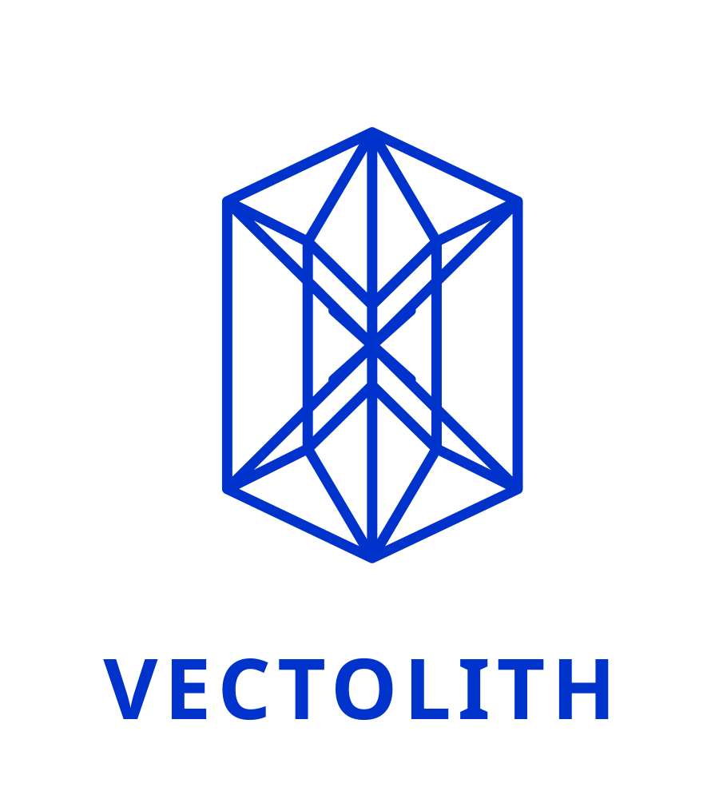
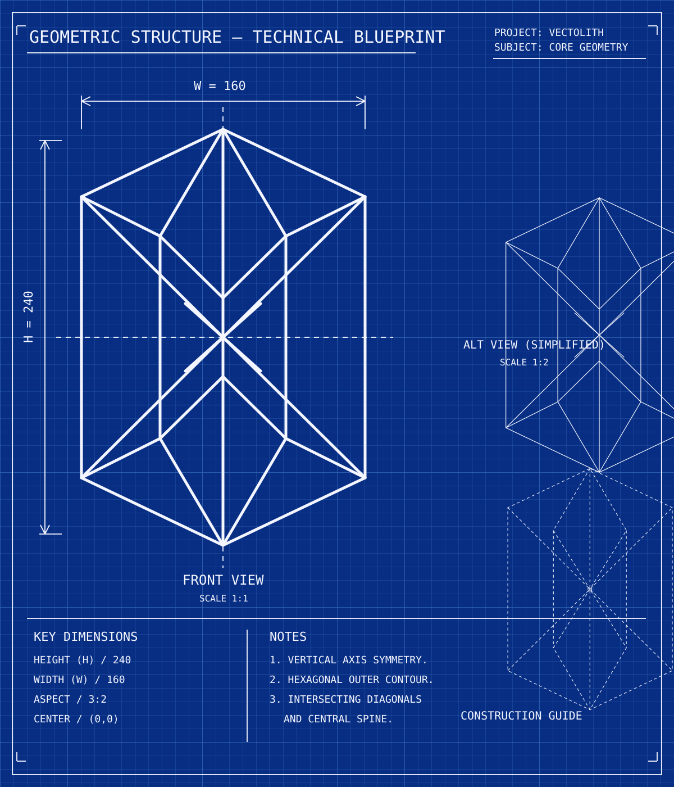
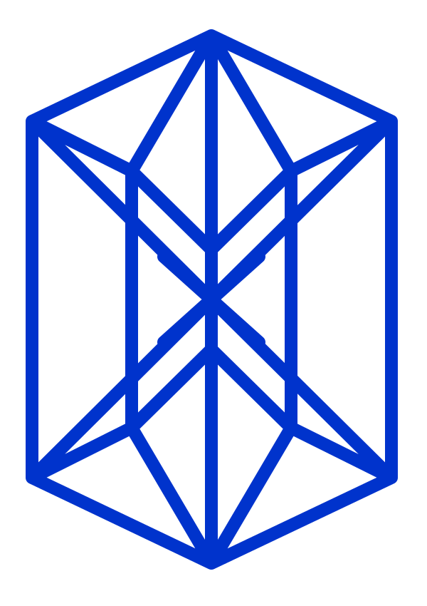
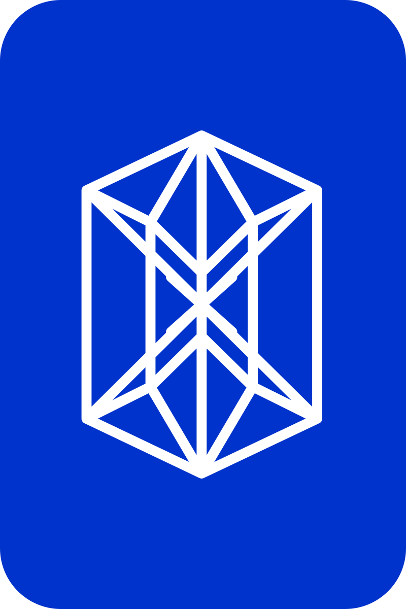

### Autonomous Intelligence · Applied Systems Engineering · Digital Ownership

**An independent technology company building products and research across AI, software, cryptography and digital ownership.**

[Portfolio](docs/PORTFOLIO_REGISTER.md) · [Engineering Governance](docs/ENGINEERING_GOVERNANCE.md) · [Product Boundaries](docs/PRODUCT_BOUNDARIES.md) · [Public Product Standard](PUBLIC_PRODUCT_STANDARD.md) · [Security](SECURITY.md)

---

Identity blueprint · Mark and wordmark construction

## About Vectolith

**Vectolith** (*VEK-to-lith*, from *Vector* + *Monolith*) is a technology company developing independent products and research projects across artificial intelligence, model development, autonomous software, digital ownership, cryptography and systems engineering.

Vectolith is the company identity and owner—not a shared product platform. Each product has its own purpose, implementation, runtime, data, authentication and authorization, deployment, operations, roadmap and release lifecycle.

Company-wide principles and standards may guide security, privacy, documentation and engineering quality. They do not create mandatory shared runtime services, databases, credentials, APIs or cross-product dependencies.

## Product portfolio

| Product | Focus | Development position |
|---|---|---|
| [Velnor](https://github.com/vectolith/velnor) | Autonomous AI agent, orchestration, integrations and execution | Active development; release and deployment evidence are assessed per release |
| [BLUD](https://github.com/vectolith/blud) | Personal agent, browser automation and credential protection | Active development; production readiness must be assessed from current release evidence |
| [Models by Vectolith](https://github.com/vectolith/Models-by-vectolith.) | Model research, specifications, foundation selection, training, evaluation and releases | Active research and evaluation; no model release is claimed here |
| [Pluco](https://github.com/vectolith/pluco-network) | Digital ownership protocol and marketplace | Development; deployment claims require independently verified chain evidence |
| [NYR](https://github.com/vectolith/NYR) | From-scratch x86-64 operating-system research | Early kernel development |
| VaultETH | Native self-custodial wallet for iOS and Android | Development |
| Cipher Messenger | Encrypted messaging | Development |
| Quietline Messenger | Encrypted messaging | Development |
| AERYN | On-chain generative art | Development |

See the [portfolio register](docs/PORTFOLIO_REGISTER.md) for documented boundaries and project status. Repository visibility and product maturity are distinct: source visibility does not establish availability or operational readiness.

## Brand identity

Vectolith's identity is maintained as modular, reusable SVG assets rather than requiring users to extract components from a poster.

Geometric emblem

| Asset | Description |
|---|---|
| [Geometric mark](assets/branding/separated/mark.svg) | Standalone symbol |
| [Wordmark](assets/branding/separated/wordmark.svg) | VECTOLITH lettering |
| [Horizontal lockup](assets/branding/separated/logo-horizontal.svg) | Symbol and wordmark side-by-side |
| [Stacked lockup](assets/branding/separated/logo-stacked.svg) | Symbol above wordmark |
| [Blueprint](assets/branding/vectolith-blueprint.svg) | Identity geometry and wordmark study |
| [Construction study](assets/branding/separated/construction.svg) | Illustrative construction reference |
| [Clear-space guide](assets/branding/separated/clear-space.svg) | Isolation and spacing illustration |
| [Color reference](assets/branding/separated/colors.svg) | Reference palette |

Typography and color guidance

- Typography direction: geometric sans-serif.
- Preferred font family: Space Grotesk.
- Fallbacks: Manrope, Avenir Next, Segoe UI, sans-serif.
- Wordmark: uppercase, semibold, optically tracked.
- Reference blue: `#0033CC`.
- White: `#FFFFFF`.

The SVG wordmark uses a font stack and is not embedded as outlined paths. For production print or applications where exact typography is required, outline the lettering in a vector editor and retain the editable original. Construction and clear-space diagrams are illustrative, not verified mechanical dimensions.

[Brand asset documentation](assets/branding/separated/README.md)

## Icon library

The repository also includes a reusable outline icon set, designed for consistent use across documentation, websites and product interfaces.

- [Browse icon library](assets/branding/icons/index.html)
- [SVG icon sprite](assets/branding/icons/icons.svg)
- [Favicon](assets/branding/icons/favicon.svg)
- [Icon inventory and usage](assets/branding/icons/README.md)

Icon system

- 36 reusable symbols.
- SVG sprite format.
- 24 × 24 viewBox.
- 2-unit outline stroke.
- Rounded caps and joins.
- Reference color: `#0033CC`.

Symbols cover navigation, applications, models, runtime, execution, compute, data, integrations, connectivity, security, access, users, settings, monitoring, tasks, scheduling, deployment, development, messaging and common actions.

## Engineering principles

1. **Product independence:** each product builds, deploys and operates independently.
2. **Public-user quality:** prioritize accessibility, clarity, reliability and safe failure.
3. **Real functionality:** do not present mock data or unverified integrations as operational features.
4. **Security and privacy:** enforce least privilege, product-owned trust boundaries and transparent data handling.
5. **Evidence-led releases:** use reproducible builds, tests, dependency review, security review and operational evidence.
6. **Dependency discipline:** document service limits, external dependencies and failure modes.
7. **Honest maturity:** distinguish research, development, prototype, beta and production.

Cross-product integration is not a default architectural requirement. Any future integration requires explicit approval, must be replaceable and must not become essential to a product's core operation.

## Governance and documentation

- [Portfolio register](docs/PORTFOLIO_REGISTER.md)
- [Engineering governance](docs/ENGINEERING_GOVERNANCE.md)
- [Product boundaries](docs/PRODUCT_BOUNDARIES.md)
- [Public product standard](PUBLIC_PRODUCT_STANDARD.md)
- [Repository audit](REPOSITORY_AUDIT.md)
- [Security policy](SECURITY.md)

---

**Vectolith**

© 2026 · Engineered with precision.

